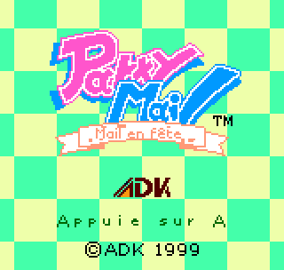
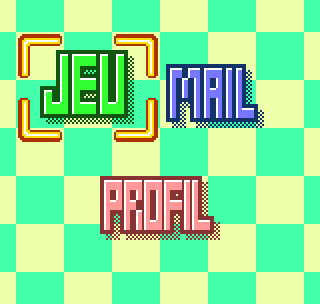
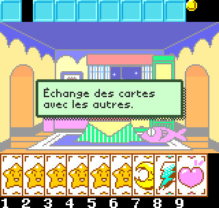

# Party Mail — traduction française

**Party Mail** (Neo Geo Pocket Color, ADK, 1999, sorti uniquement au Japon), entièrement en français :
le jeu de cartes et ses aides, les menus, le profil du joueur, le clavier, le dictionnaire de mots pour
écrire des mails, les écrans de liaison par câble, les résultats, et toutes les répliques des cinq
bestioles, chacune avec son caractère. L'écran titre et le menu principal sont redessinés en français.

<p align="center">
  
  
  
</p>

- **Partie 1 (français)** : jouer en français — le patch et comment l'appliquer.
- **Part 2 (English)** : the translation kit — tools and guide to translate the game into another language.

---

# Partie 1 — Jouer en français

## 1.1 Ce qu'il vous faut

Le patch : `patch/PartyMail_FR_v1.0.ips`

**Votre propre** copie de la cartouche **japonaise**, non modifiée et sans en-tête. Aucune ROM n'est
fournie ici. Vérifiez-la :

| | Party Mail (Japon) |
|---|---|
| Nom (par exemple) | `Party Mail (Japan).ngc` |
| Taille | 1 048 576 octets |
| CRC32 | `E4F17BD1` |
| MD5 | `34276443719ad3678d21c12c783ab15e` |
| SHA-1 | `eea5fdbd2e2aa2454b0c06adef7a1a1770603653` |

Si votre fichier contient déjà une partie sauvegardée (certains émulateurs l'écrivent dans la ROM), ses
empreintes seront différentes : ce n'est pas grave, le patch s'applique quand même. Avec une ROM déjà
modifiée ou un autre dump, le patch donnera un jeu cassé.

## 1.2 Méthode A — patch appliqué à la volée par l'émulateur

L'émulateur applique le patch en mémoire à chaque lancement : la ROM d'origine n'est **pas modifiée**.
Posez le fichier `.ips` à côté de la ROM, **sous le même nom**, puis lancez la ROM normalement :

```
Party Mail (Japan).ngc
Party Mail (Japan).ips
```

Ce patch **agrandit** la ROM (1 Mio → 2 Mio). En cas de souci avec l'application à la volée, utilisez la
méthode B.

## 1.3 Méthode B — créer une ROM française (console, ou tout autre émulateur)

Fabriquez une fois pour toutes une ROM patchée :

- avec un outil IPS courant : **Rom Patcher JS** (dans le navigateur), **Flips** ou **Lunar IPS** ;
  choisissez la ROM, puis le `.ips`, et enregistrez le résultat ;
- ou avec l'outil fourni (Python 3) :

  ```
  python tools/ips.py apply "Party Mail (Japan).ngc" patch/PartyMail_FR_v1.0.ips PartyMail_FR.ngc
  ```

Depuis la ROM d'origine attendue, la ROM obtenue doit avoir ces empreintes, quel que soit l'outil :

| | Party Mail (FR) |
|---|---|
| Taille | 2 097 152 octets |
| CRC32 | `48E19BB5` |
| SHA-1 | `87a4cd4e2b2933c38cfddeff6fef200c05d0c965` |

## 1.4 Premier lancement et sauvegarde

La ROM française démarre **sans sauvegarde** : au premier lancement, le jeu vous fait créer votre profil
(votre nom, votre anniversaire, ce que vous aimez ou détestez, votre envie du moment), puis choisir votre
bestiole, sa couleur et son nom. Le dictionnaire de mots pour écrire des mails est alors en français.

Le jeu d'origine enregistre sa partie en fin de cartouche. La ROM traduite étant deux fois plus grande, la
sauvegarde est rangée à la fin de la nouvelle taille (le jeu contient déjà le code prévu pour les
cartouches de cette taille). Une sauvegarde faite avec la version japonaise n'est pas reprise.

## 1.5 Ce qui a été vérifié, ce qui ne l'a pas été (v1.0)

Vérifié à l'émulateur : écran titre, menu principal (JEU / MAIL / PROFIL), création et modification du
profil, clavier (trois pages et commandes), dictionnaire de mots, saisie d'un message, écrans de liaison
et de recherche de partenaire, partie contre l'ordinateur (aides, menus de tour, menus de la bestiole,
bulles des bestioles, panneaux « GO ! »), résultats, coupure de liaison, enregistrement de la sauvegarde.

Tout le texte est contrôlé automatiquement (largeur en pixels contre la place de chaque boîte, variables
comptées au plus large, caractères disponibles).

Pas encore vu à l'écran en situation : le classement de fin de partie (vérifié hors du jeu), quelques
bulles rares (« Grondé par… », « Négociation… »), les échanges de mails entre deux consoles par câble.
Un retour est bienvenu si un texte déborde ou se coupe. La ROM n'a pas encore été essayée sur une vraie
console.

## 1.6 Choix de traduction

- Traduit depuis le **japonais** (il n'existe pas d'autre version). On **adapte** plutôt qu'on ne traduit
  mot à mot : chaque réplique doit avoir du sens dite par ce personnage.
- Les **cinq bestioles** gardent leur caractère : le chien crâneur, l'oiselle enjouée, la chatte
  coquette, la petite bête timide, et le robot qui parle en majuscules, par phrases de machine, et
  vouvoie. Les répliques liées aux fêtes du calendrier japonais sont adaptées quand un équivalent existe
  (la *Golden Week* devient « Vive les ponts de mai ! »).
- Les *pets* deviennent des **bestioles** (le mot anglais ne passe pas en français).
- Police : lettres à **largeur variable** dans les bulles, aides et menus (environ 1,6 lettre par case au
  lieu d'une), minuscules et lettres accentuées (é è ê ë à â î ï ô û ù ü ç œ É È Ê Ë À Ç Ô Î Œ « » …).
  Les bulles des bestioles et les menus de partie ont été élargis.
- Clavier : les pages hiragana et katakana deviennent **MAJ** (capitales et accents) et **min**
  (minuscules et accents) ; la page latine d'origine est gardée (**ABC**).
- Graphismes redessinés : menu principal (« JEU / MAIL / PROFIL »), sous-titre du logo
  (« Mail en fête »), panneaux « GO ! » et « STOP ! », classements « 1er », « 2e »… Laissés tels quels :
  le logo *Party Mail*, « WIN », « LOSE » et « GAMEOVER ».

## 1.7 Crédits

- **Traduction française, police, graphismes, outils** : **Tixul**, sous **licence MIT** (fichier
  `LICENSE`) pour les outils et les fichiers de traduction.
- *Party Mail* © 1999 ADK / SNK. Ce projet de fans n'est ni affilié ni approuvé par les ayants droit.
  Il ne contient **ni ROM, ni BIOS, ni texte d'origine** : le patch ne contient que des octets modifiés,
  et le texte japonais n'est obtenu qu'en l'extrayant de sa propre ROM.

---

# Part 2 — Translation kit (English)

Everything needed to translate the game into **another Latin-alphabet language**. You edit text files;
the tools rebuild the ROM (2 MiB, variable-width font in balloons, help boxes and menus, wider balloons
and menus, accented 8×8 font for the keyboard and profile screens, redrawn fixed screens and signs) and
refuse to build while a rule is broken.

| Folder / file | Content |
|---|---|
| `lang/fr/` | the French translation (`textes.tsv`) and its style guide `CONSIGNES.md` — use it as your template |
| `tools/` | extract the text, check a translation, build the translated ROM and the IPS patch |
| `patch/` | the released French patch |
| `screenshots/` | the screenshots shown at the top of this file |
| `FORMAT.md` | technical notes on the ROM: text, font, screens, saves (in French) |

## 2.1 Requirements
- Python 3.9 or later (no other package needed).
- The original **Japanese ROM** `Party Mail (Japan).ngc` (hashes in section 1.1): the game is rebuilt
  from it. The build checks it and refuses any other file (a save stored inside the file is ignored).

## 2.2 Steps
1. **Extract the text** from *your own* ROM (it is not distributed):
   ```
   python tools/extrait.py "Party Mail (Japan).ngc"
   ```
   This writes `out/jp.tsv` (`key · references · room in pixels · Japanese`) and the original font
   (`out/police_jp.bin`, used to measure the text).
2. **Copy** `lang/fr` to `lang/<code>` (e.g. `lang/es`) and translate `textes.tsv` (rules below).
3. **Check, then build** the ROM and the patch, and test in an emulator:
   ```
   python tools/controle.py --lang <code>
   python tools/build.py --rom "Party Mail (Japan).ngc" --lang <code> --ips
   ```
   Output: `out/<code>.ngc` and `out/<code>.ips` (checked by re-applying it).
   ⚠️ Distribute the **.ips** only, never the ROM.

## 2.3 File format and rules

`lang/<code>/textes.tsv` — one line per string: `key<TAB>text` (UTF-8); `#` starts a comment line.
- `C.xxxxx`: strings used by the game code (menus, help boxes, results…);
- `Lnn.ii`: string `ii` of list `nn`: 04 = title, profile prompts and profile keyboard rows (fixed-width
  8×8 font: 1 character = 8 px), 24/31/32/33/34 = the five pets' lines (dog, bird, cat, robot, timid),
  35 = pets' lines during a game (5 × 11 events);
- `COMMUN.nn`: calendar lines 0-29 shared by the dog, bird, cat and timid pet (lists 24, 31, 32, 34);
- keep the variables `{FF 00}` (month) `{FF 01}` (day) `{FF 02}` (pet name) `{FF 03}`…`{FF 06}` (liked /
  disliked food and person) `{FF 07}` (current wish) `{FF 10}` (player); `{xx}` writes a raw byte;
- room: pets' balloons 128 px, help boxes 96 px per line, game menus 40 px; `tools/controle.py` lists
  every overflow (variables counted at their widest).

Characters: `A-Z a-z 0-9`, `. , ; : ! ? - ' " ( ) / + ~ ♡`, `…`, `« »` and
`é è ê ë à â î ï ô û ù ü ç œ É È Ê Ë À Ç Ô Î Œ`, drawn on unused kana codes (`ACCENTS` in
`tools/police.py`: change them there for your language).

Language-specific data living in the tools (edit them for your language):
`tools/ecrans.py` (`CHAMPS`: text of the fixed screens — save, groups, dictionary, message, link, pet
choice, console ID, number of players, points), `tools/clavier.py` (keyboard pages, command labels,
the 80 dictionary words), `tools/lettrage.py` (main menu words, signs, rank suffixes, logo subtitle).

The variable-width routine is `tools/asm/vwf.asm`, shipped assembled (`vwf.bin`). To change it, install
the Macro Assembler AS (`asl`, `p2bin`) and set `ASL_DIR` to its folder before building.

## 2.4 Credits and legal
- French translation, font, graphics and tools: **Tixul**, released under the **MIT License**
  (see `LICENSE`).
- *Party Mail* © 1999 ADK / SNK. This fan project is not affiliated with or endorsed by the rights
  holders. It contains **no ROM, no BIOS and no original game text**; the Japanese text is only obtained
  by extracting it from your own ROM.
